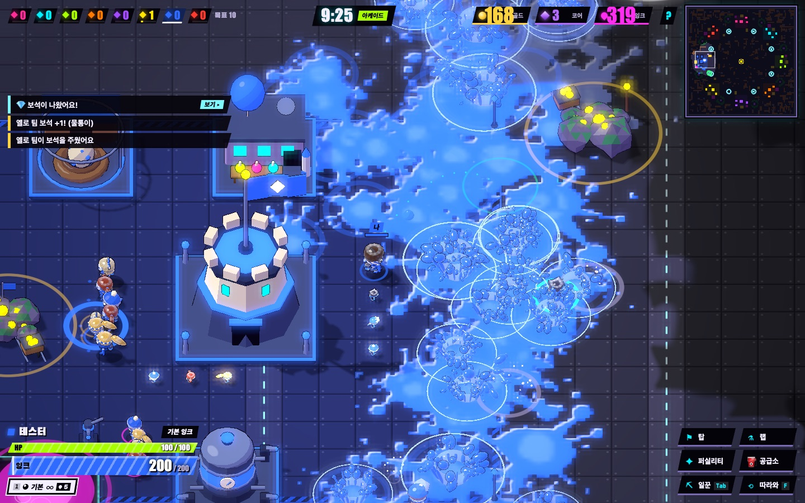
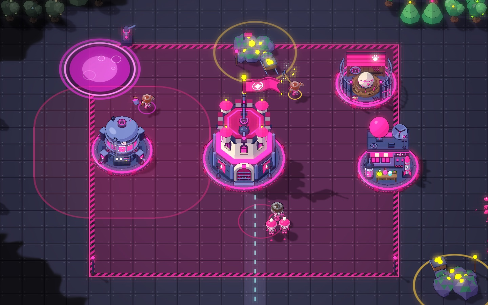
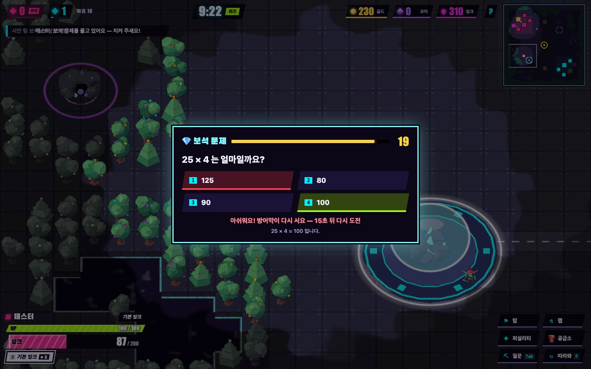
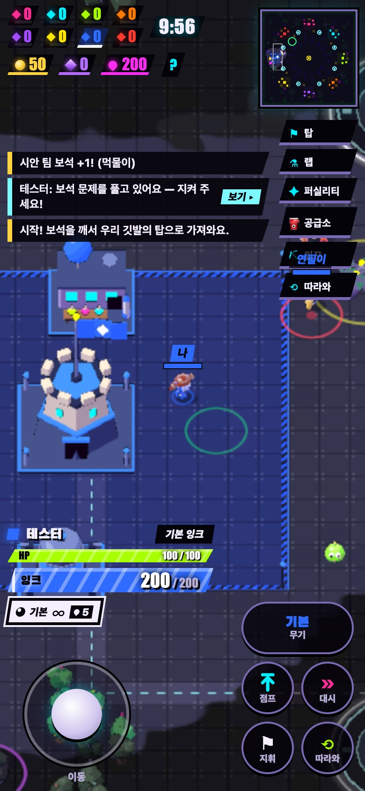

# INK BRAWLS REALMS — 잉크 브로울스 왕국전

교실에서 함께 하는 **팀 전략 · 난투 게임**이에요.

- 가입 없이 **닉네임과 채널 코드**만 있으면 모일 수 있어요. 빈자리에는 방장이 컴퓨터를 넣어요.
- 잉크 풍선을 던지는 **잉크 브로울스의 난투**를 느리게 옮겨 오고, 그 위에 일꾼 · 잉크봇 · 몬스터를 부리는 **작은 전략 층**을 얹었어요.
- three.js 로 그린 2.5D 화면이고, 브라우저(데스크톱 · 휴대폰)에서 바로 돌아가요.

> **바로 해 보기** → https://ink-realms.lopapps.com
>
> 이 레포는 그 게임의 공개판 소스예요. 빠진 것은 아래 [공개판에 대해](#공개판에-대해)에 적어 두었어요.



## 이기는 방법 — 셋 중 하나

- 💎 **보석 10점을 먼저 모으기**
  - 맵의 보석 섹션에서 방어막과 바위를 깨면 보석이 나와요.
  - 보석을 머리에 이고 우리 **깃발의 탑**으로 가져오면 점수예요(가운데 보석은 2점).
  - 시간이 다 되면 보석이 가장 많은 팀이 이겨요.
- ⚔ **적 영웅을 모두 쓰러뜨리기**
  - 영웅은 목숨이 3개예요. 한 팀의 영웅이 모두 쓰러지면 그 팀은 탈락해요.
  - 목숨을 다 쓴 학생은 **지휘관**이 되어 일꾼 · 봇 · 몬스터를 부려요.
- 🏰 **적의 깃발의 탑을 모두 부수기**
  - 탑이 부서진 팀은 바로 탈락해요. 마지막까지 남은 팀이 이겨요.

## 한 판의 흐름

- 팀은 2~8개, 팀마다 1~4명(모두 32명까지)이에요.
- 팀마다 맵 바깥 고리에 본진이 있어요: **깃발의 탑 · 잉크 공급소 · 잉크 무기 랩 · 몬스터 퍼실리티**.
- 학생마다 **영웅 1명 + 일꾼**을 부려요.
  - 일꾼은 명령을 기다려요(머리 위 "일 시켜주세요!").
  - **금광**(골드) · 숲속 **코어 금광**(코어) · **잉크 연못**(잉크)에서 캐요.
- 자원은 **학생마다 따로**예요. 내 일꾼이 캔 만큼 내가 쓰고, 팀원에게 보낼 수 있어요.
  - 골드 → 무기 랩에서 무기 열기 · 묶음 사기(브로울스식 소지품), 일꾼, 랩 · 퍼실리티 단계와 연구
  - 코어 → 잉크봇 · 몬스터 사기(쓰러지면 다시 사야 해요)
  - 잉크 → 영웅의 200 잉크 탱크를 공급소 곁에서 채우기(잉크가 없으면 던질 수 없어요)
- 모드는 둘이에요.
  - **아케이드**(기본): 방어막 → 바위를 깨면 보석이 나와요.
  - **퀴즈 모드**: 방어막을 깨면 문제가 나오고, 맞히면 보석이 나와요. 푸는 동안 그 학생은 공격받지 않아요.
- 맵 3종(잉크 숲 · 잉크 수로 · 블록 공장), 중립 몬스터, 보석을 지키는 가운데 보스가 있어요.

| 본진 | 퀴즈 모드 |
|---|---|
|  |  |
| 깃발의 탑 · 공급소 · 랩 · 퍼실리티 · 금광 · 연못 | 방어막을 깨면 나오는 보석 문제 |

<p></p>

휴대폰에서도 같은 경기에 들어올 수 있어요.

## 조작

### 데스크톱 — 키보드와 마우스 모두 돼요

| 입력 | 뜻 |
|---|---|
| `W` `A` `S` `D` · 방향키 | 영웅 달리기 · 같은 방향 두 번 = 대시 |
| 오른쪽 클릭(아무것도 안 골랐을 때) | 영웅이 길을 찾아 그곳으로 걸어가요(마우스만으로도 할 수 있어요) |
| 왼쪽 클릭 | 던지기 · 꾹 누르면 큰 풍선 |
| 소지품 칸 클릭 · `Q` `E` · `2`~`9` | 무기 바꾸기 |
| 왼쪽 끌기 · `Tab` | 내 일꾼 · 잉크봇 · 몬스터 고르기 · 일꾼 모두 |
| 오른쪽 클릭(유닛을 골랐을 때) | 명령: 땅 = 이동 · 적 = 공격 · 금광 · 연못 = 캐기 · 보석 = 줍기 |
| 영웅 곁 오른쪽 클릭 · `F` | 따라와(자동 팀 구성) |
| `X` · `B` | 공격할 적 고르기 · 일꾼으로 공급소 짓기 |
| `Space`+끌기 · 휠 버튼 끌기 | 화면 옮기기 |
| `Space`+휠 | 확대 · 축소 |
| `C` · `1` · 미니맵 클릭 | 내 영웅으로 · 본진 보기 · 그곳 보기 |
| `H` · `?` | 도움말 |

### 휴대폰

- 왼쪽 판으로 이동하고, 화면을 누르면 던져요.
- **지휘**를 켜면 누르기가 고르기 · 명령으로 바뀌어요.

## 실행

Node 20 이상이 필요해요.

```bash
npm install
npm run dev                  # 서버(3100) + Vite(5174) → http://localhost:5174
npm test                     # 시험(node --test)
npm run build && npm start   # 서버 하나가 화면과 게임을 함께 → http://localhost:3100
```

### 교실에서 띄우기

1. 선생님 컴퓨터에서 `npm run build && npm start` 를 해요.
2. 같은 와이파이의 학생들은 `http://선생님컴퓨터IP:3100` 으로 들어와요.

### 환경 변수

| 이름 | 기본 | 뜻 |
|---|---|---|
| `PORT` | 3100 | HTTP · WebSocket 포트 |
| `GAME_SPEED` | 1 | 개발 · 시연용 — 4 면 경기가 네 배 빨리 흘러요 |
| `ARCHIVE_API` | 없음(꺼짐) | 퀴즈 아카이브 주소 — 서버가 고른 세트를 받아 와요 |
| `VITE_ARCHIVE_API` | 없음(꺼짐) | 빌드할 때 화면이 쓸 퀴즈 아카이브 주소 — 고르기 · 만들기 · 고치기 창 |

## 공개판에 대해

- 게임 규칙 · 화면 · 서버 시뮬레이션 · 컴퓨터 플레이어 · 소리 · 시험이 모두 들어 있어요.
- 운영 서버에만 쓰는 설정(배포 파일, 접속 · 메시지 한도 같은 보호 장치)은 빠져 있어요.
  - 인터넷에 공개 서버로 띄운다면 이런 보호 장치를 직접 더해 주세요.
- 퀴즈 아카이브는 기본으로 꺼져 있어요.
  - 꺼 둔 채로도 기본 퀴즈 세트 8개(초등 수학 · 과학 · 영어, 중학 수학 · 과학, 고등 원소 기호, 상식)로 퀴즈 모드를 할 수 있어요.
  - 브로울스 꼴의 아카이브 주소(`GET /api/quizzes/:id`)를 주면 아카이브 고르기 · 만들기 · 복사 · 고치기가 켜져요.
- `src/brawls/` 는 같은 만든이의 「잉크 브로울스」에서 옮겨 온 렌더러예요. `[왕국전]` 표시가 붙은 곳을 고쳤어요.

## 구조

| 폴더 | 내용 |
|---|---|
| `shared/` | 서버와 화면이 함께 쓰는 규칙 — constants(균형 수치 전부) · map(맵 3종) · path(A*) · move(영웅 몸) · protocol(주고받는 꼴) · quizseed(기본 퀴즈) |
| `server/` | index(HTTP · WebSocket) · lobby(채널 · 팀 · 컴퓨터 · 퀴즈) · game(20Hz 시뮬레이션) · bots(유닛 두뇌 · 컴퓨터 플레이어) · quizbook · quizsource |
| `src/` | main · net · world(보간 · 시야) · hero(내 영웅) · control(조작) · touch · ui/(hud · lobby · panels · infocard · archive · rules) · audio/ |
| `src/render/` | brawlscene(맵 · 스냅숏 → 렌더러) · quality(화질 · 해상도 자동 조절) |
| `src/brawls/` | 잉크 브로울스에서 옮겨 온 렌더러 |
| `test/` | 시험(node --test) |
| `docs/DESIGN.md` | 설계와 결정 기록(§0 에 사용자 결정 U1~) |

- 판정은 모두 서버가 해요. 내 영웅의 움직임만 화면이 먼저 하고 서버가 확인해요.
- 유닛 · 건물 · 보석은 바이너리 스냅숏으로, 그 밖은 JSON 으로 주고받아요.
- 균형 수치는 모두 `shared/constants.js` 한 곳에 있어요.

## 라이선스

[MIT](LICENSE)

함께 쓰는 것:

- [three.js](https://threejs.org) — MIT
- [ws](https://github.com/websockets/ws) — MIT
- [Black Han Sans](https://github.com/zesstype/Black-Han-Sans) 글꼴 — SIL OFL 1.1
